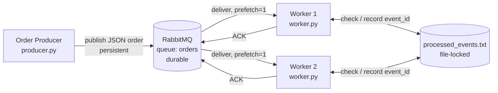
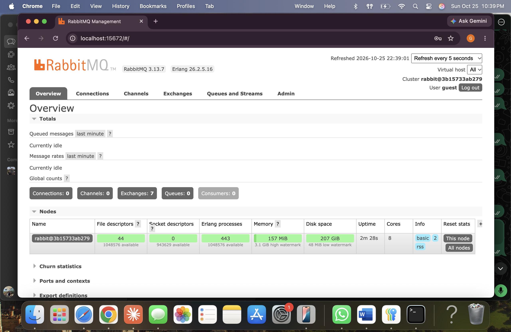
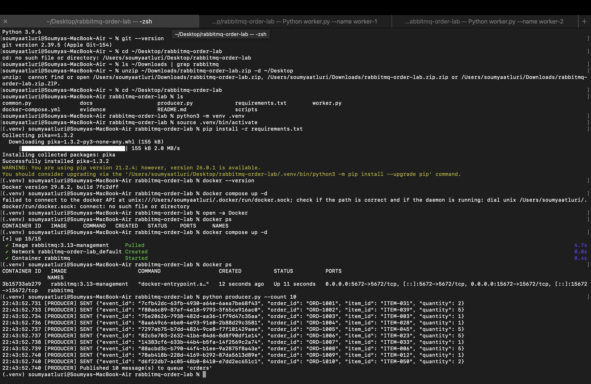
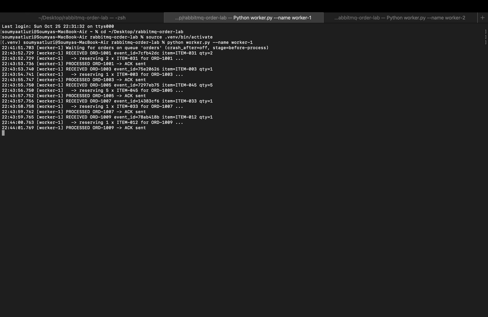
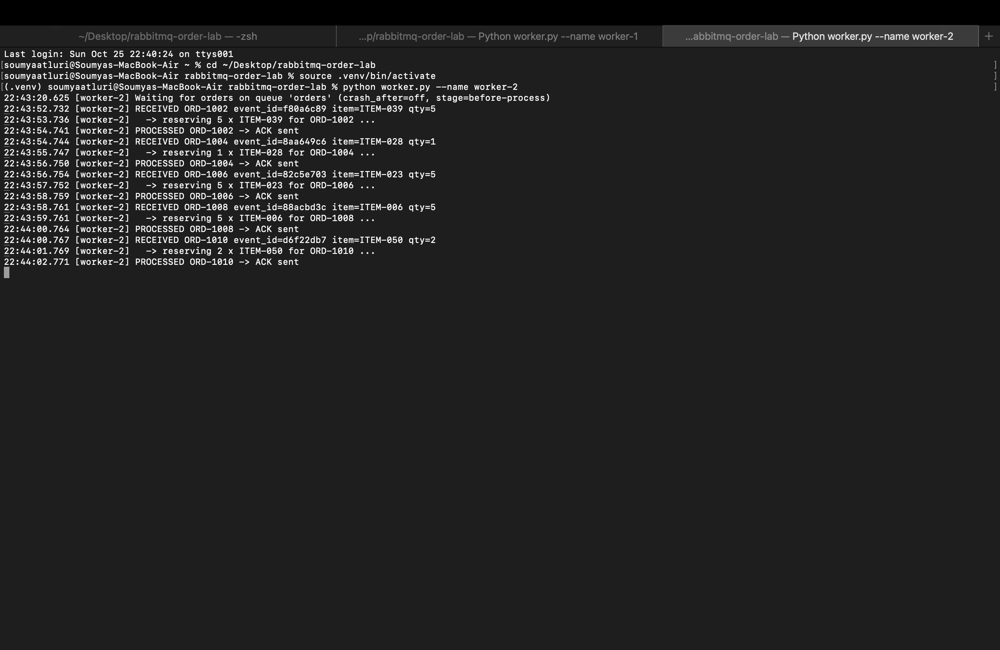
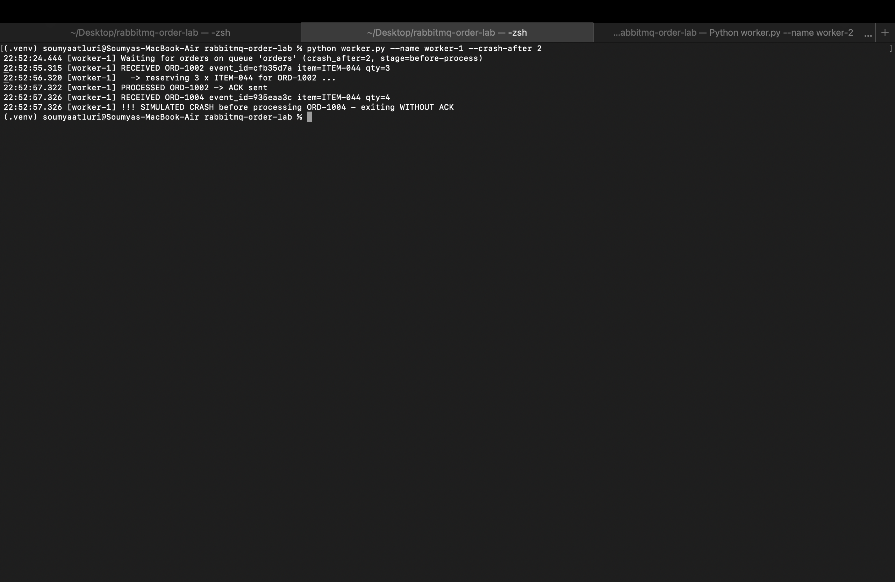
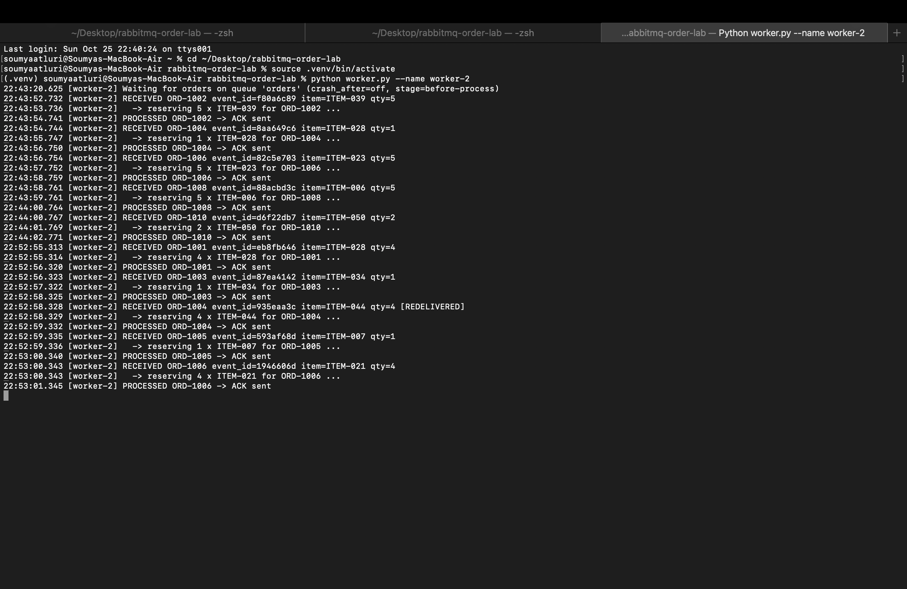
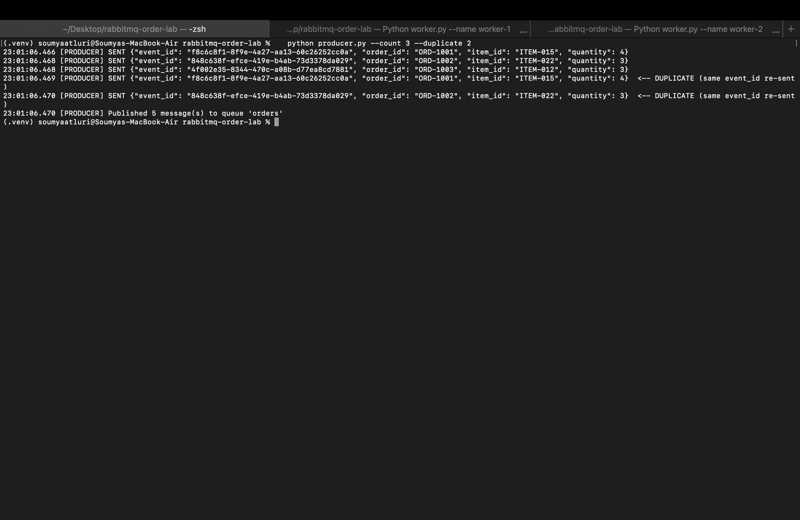
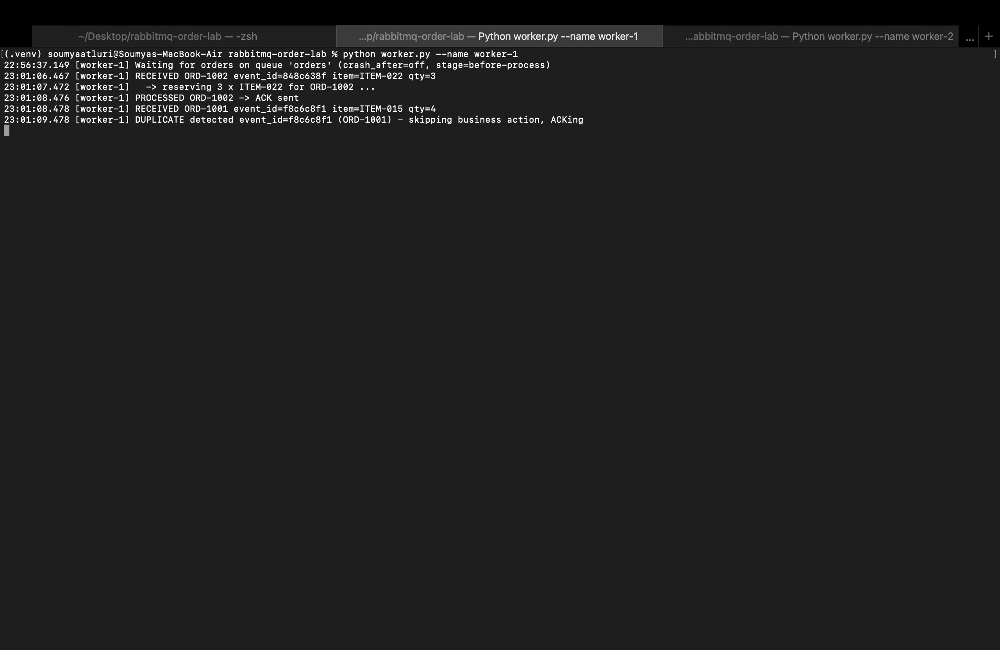
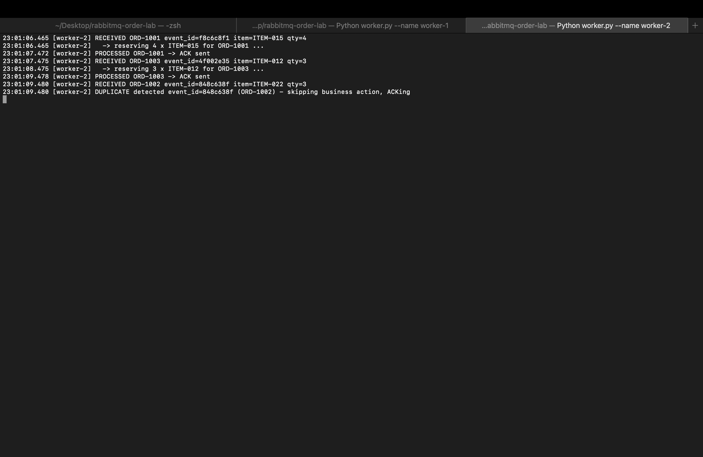

# RabbitMQ Order Processing Lab (Python)

A small asynchronous messaging system:

- **Order Producer** (`producer.py`) publishes order messages (`event_id`, `order_id`, `item_id`, `quantity`) to the `orders` queue.
- **Order Worker** (`worker.py`) consumes orders, logs them, runs the business action, then sends a manual **ACK**.

Producer and workers are independent processes. Two workers on the same queue act as **competing consumers**. Workers can simulate a crash before ACK to show **redelivery**, and every worker checks a shared `processed_events.txt` file so a repeated `event_id` is **not processed twice** (idempotency).

---

## Architecture



```
                         +---------------------+
  +-----------+  publish |      RabbitMQ       |  deliver   +-----------+
  | Producer  | -------> |   queue: "orders"   | ---------> | Worker 1  |--+
  +-----------+          |  (durable, manual   | ---------> | Worker 2  |--+
                         |   ACK, prefetch=1)  | <--- ACK --+-----------+  |
                         +---------------------+                           |
                                                     processed_events.txt <+
                                                     (dedupe by event_id)
```

### Key design choices

| Concern | How it is handled |
|---|---|
| Delivery guarantee | `auto_ack=False`; worker ACKs only **after** processing finishes. |
| Fair dispatch | `basic_qos(prefetch_count=1)` – each worker holds at most one un-ACKed message. |
| Failure | If a worker dies before ACK, RabbitMQ sees the connection close and **requeues** the message; another worker gets it with `redelivered=True`. |
| Duplicates | Workers share `processed_events.txt`. Check + process + record runs under an exclusive file lock (`fcntl.flock`), so an `event_id` is processed at most once. |
| Durability | Durable queue + persistent messages (`delivery_mode=2`) + publisher confirms. |

---

## Project structure

```
.
├── docker-compose.yml      # RabbitMQ + management UI
├── requirements.txt        # pika
├── common.py               # connection, queue, logging helpers
├── producer.py             # Order Producer
├── worker.py               # Order Worker (ACK, crash simulation, dedupe)
├── scripts/run_demo.sh     # runs all scenarios, saves logs to evidence/
├── evidence/               # captured logs
└── docs/                   # screenshots
```

---

## How to run

### 1. Prerequisites
- Docker Desktop
- Python 3.9+

### 2. Start RabbitMQ
```bash
docker compose up -d
```
Management UI: http://localhost:15672 (user `guest`, password `guest`).

### 3. Install Python dependencies
```bash
python3 -m venv .venv
source .venv/bin/activate          # Windows: .venv\Scripts\activate
pip install -r requirements.txt
```

### 4. Run workers and producer (each in its own terminal)
```bash
# Terminal 1
python worker.py --name worker-1
# Terminal 2
python worker.py --name worker-2
# Terminal 3
python producer.py --count 10
```

### Options
| Command | Purpose |
|---|---|
| `python producer.py --count N` | Publish N orders |
| `python producer.py --count 3 --duplicate 2` | Publish 3 orders, then re-send the first 2 with the **same** `event_id` |
| `python worker.py --name worker-1 --crash-after 2` | Crash on 2nd received message **before** processing and ACK |
| `python worker.py --name worker-1 --crash-after 1 --crash-stage after-process` | Process the message, then crash **before** ACK |

### 5. (Optional) Run every scenario with one script
```bash
./scripts/run_demo.sh
```
Logs are saved in `evidence/`.

### 6. Stop
`Ctrl+C` the workers, then `docker compose down`.

---

## Evidence

All results below come from real runs on macOS with RabbitMQ 3.13.7 in Docker. The producer and the workers each ran in their own Terminal tab. Screenshots are in [`docs/`](docs/).

### 0. RabbitMQ running


### 1. Successful message processing
Command: `python producer.py --count 10`, with `worker-1` and `worker-2` running.

```text
22:43:52.731 [PRODUCER] SENT {"event_id": "7cfb42dc-63fb-4930-a64e-6aea7be68f43", "order_id": "ORD-1001", "item_id": "ITEM-031", "quantity": 2}
22:43:52.733 [PRODUCER] SENT {"event_id": "f80a6c89-87ef-4e18-9793-3f65ce916ac0", "order_id": "ORD-1002", "item_id": "ITEM-039", "quantity": 5}
...
22:43:52.740 [PRODUCER] SENT {"event_id": "d6f22db7-ac05-48b0-8410-e7dd2ec651c1", "order_id": "ORD-1010", "item_id": "ITEM-050", "quantity": 2}
22:43:52.740 [PRODUCER] Published 10 message(s) to queue 'orders'
```

Each order goes through the steps **RECEIVED → business action → PROCESSED → ACK**:

```text
22:43:52.729 [worker-1] RECEIVED ORD-1001 event_id=7cfb42dc item=ITEM-031 qty=2
22:43:52.729 [worker-1]   -> reserving 2 x ITEM-031 for ORD-1001 ...
22:43:53.736 [worker-1] PROCESSED ORD-1001 -> ACK sent
```



### 2. Two competing consumers
The 10 orders were split between the two workers. **No order was handled by both workers.**

| worker-1 | worker-2 |
|---|---|
| ORD-1001, 1003, 1005, 1007, 1009 | ORD-1002, 1004, 1006, 1008, 1010 |

```text
22:43:53.736 [worker-1] PROCESSED ORD-1001 -> ACK sent
22:43:54.741 [worker-2] PROCESSED ORD-1002 -> ACK sent
22:43:55.747 [worker-1] PROCESSED ORD-1003 -> ACK sent
22:43:56.750 [worker-2] PROCESSED ORD-1004 -> ACK sent
22:43:57.752 [worker-1] PROCESSED ORD-1005 -> ACK sent
22:43:58.759 [worker-2] PROCESSED ORD-1006 -> ACK sent
22:43:59.762 [worker-1] PROCESSED ORD-1007 -> ACK sent
22:44:00.764 [worker-2] PROCESSED ORD-1008 -> ACK sent
22:44:01.769 [worker-1] PROCESSED ORD-1009 -> ACK sent
22:44:02.771 [worker-2] PROCESSED ORD-1010 -> ACK sent
```

| worker-1 | worker-2 |
|---|---|
|  |  |

### 3. Failure and redelivery
`worker-1` was restarted with `--crash-after 2`, and then `python producer.py --count 6` was run.

**worker-1** received ORD-1004 and exited **without sending an ACK**:
```text
22:52:55.315 [worker-1] RECEIVED ORD-1002 event_id=cfb35d7a item=ITEM-044 qty=3
22:52:57.322 [worker-1] PROCESSED ORD-1002 -> ACK sent
22:52:57.326 [worker-1] RECEIVED ORD-1004 event_id=935eaa3c item=ITEM-044 qty=4
22:52:57.326 [worker-1] !!! SIMULATED CRASH before processing ORD-1004 - exiting WITHOUT ACK
```

RabbitMQ requeued the unacknowledged message, and **worker-2** received the **same message** (same `event_id=935eaa3c`) marked as redelivered:
```text
22:52:58.328 [worker-2] RECEIVED ORD-1004 event_id=935eaa3c item=ITEM-044 qty=4 [REDELIVERED]
22:52:58.329 [worker-2]   -> reserving 4 x ITEM-044 for ORD-1004 ...
22:52:59.332 [worker-2] PROCESSED ORD-1004 -> ACK sent
22:52:59.335 [worker-2] RECEIVED ORD-1005 event_id=593af68d item=ITEM-007 qty=1
22:53:01.345 [worker-2] PROCESSED ORD-1006 -> ACK sent
```
worker-2 kept processing the remaining orders, and the system stayed up.

| worker-1 (crash, no ACK) | worker-2 (redelivery) |
|---|---|
|  |  |

### 4. Duplicate handling
Command: `python producer.py --count 3 --duplicate 2`. It sends ORD-1001 to ORD-1003, then re-sends ORD-1001 and ORD-1002 with the **same `event_id`**.

```text
23:01:06.466 [PRODUCER] SENT {"event_id": "f8c6c8f1-...", "order_id": "ORD-1001", ...}
23:01:06.468 [PRODUCER] SENT {"event_id": "848c638f-...", "order_id": "ORD-1002", ...}
23:01:06.468 [PRODUCER] SENT {"event_id": "4f002e35-...", "order_id": "ORD-1003", ...}
23:01:06.469 [PRODUCER] SENT {"event_id": "f8c6c8f1-...", "order_id": "ORD-1001", ...}  <-- DUPLICATE (same event_id re-sent)
23:01:06.470 [PRODUCER] SENT {"event_id": "848c638f-...", "order_id": "ORD-1002", ...}  <-- DUPLICATE (same event_id re-sent)
```

Each event was processed **once**. When the second copy arrived, the worker found the `event_id` in `processed_events.txt`, skipped the business action, and still sent an ACK:
```text
23:01:07.472 [worker-2] PROCESSED ORD-1001 -> ACK sent
23:01:08.476 [worker-1] PROCESSED ORD-1002 -> ACK sent
23:01:09.478 [worker-2] PROCESSED ORD-1003 -> ACK sent
23:01:09.478 [worker-1] DUPLICATE detected event_id=f8c6c8f1 (ORD-1001) - skipping business action, ACKing
23:01:09.480 [worker-2] DUPLICATE detected event_id=848c638f (ORD-1002) - skipping business action, ACKing
```

Because the store is shared, a duplicate is caught **even when it reaches a different worker** from the one that processed the original.



| worker-1 | worker-2 |
|---|---|
|  |  |

---

## Reflection

A message can be delivered more than once because RabbitMQ only removes a message after it gets an ACK. If a worker crashes, loses its connection, or times out after receiving a message but before its ACK arrives, the broker cannot tell whether the work was done, so it requeues the message for another consumer (at-least-once delivery). Producers can also re-send the same event after a network retry. Idempotent handling makes this safe: by recording each `event_id` and checking it before running the business action, a repeated delivery is recognized and ACKed without being processed again. The result is effectively-once processing on top of at-least-once delivery.
